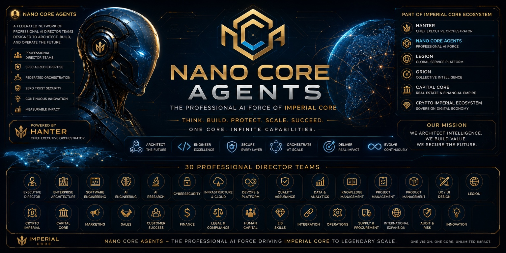

# Nano Core Agents

**Project creator & founding architect:** **Alexander Nikolaevich Romaskevich** (Alexander Nikolaevich Romaskevich · RomaskevicH). [Authorship & contribution provenance](AUTHORS.md).

  

*Concept illustration: the teams, integrations and capabilities shown are architectural ambitions; their operation requires separate evidence.*

Governed professional AI-agent architecture with dynamically assigned roles, bounded capabilities and multiple organizational structures.

**Status: architecture plus an offline synthetic policy exercise.** This
exercise does not train or deploy autonomous agents or implement the live
Guardian Core / Approval Gateway. See [NCA simulation lab](nca_lab/README.md) and the [offline governed team handoff guard](nca_lab/HANDOFF_GUARD.md).

## Official IMPERIAL Core web identity

**[Alexander Romaskevich — official founder site](https://oromaskevic23-cmd.github.io/oromaskevic23-cmd/)** · **[IMPERIAL Core — official ecosystem site](https://oromaskevic23-cmd.github.io/Capital-Core-Public/)**

Alexander Romaskevich · RomaskevicH — founder-declared Architect, Owner and CEO of IMPERIAL Core. Both owner-maintained GitHub Pages sites provide 10 language versions. Their visibility on the public web is established; Google Search Console verification and indexing are separate, not claimed by these links.

## Founder and architectural authority

**Alexander Romaskevich — RomaskevicH**  
Founder • Owner • CEO of IMPERIAL Core  
Architect / Final Architectural Decision Authority

**HANTER — AI Command Center / Chief Systems** operates under the founder's architectural decisions. This role does not imply a single unrestricted global orchestrator.

## Professional domains under consideration

The planned federated teams span architecture, software and AI engineering, research, security, infrastructure, quality assurance, data, product, operations, finance and other professional domains. Team assignments and sizes are dynamic; the illustration is not a count of active teams.

Related projects: [HANTER](https://github.com/oromaskevic23-cmd/HANTER-Public) · [LEGION](https://github.com/oromaskevic23-cmd/Legion-Public) · [NDB](https://github.com/oromaskevic23-cmd/N.D.B-) · [IMPERIUM](https://github.com/oromaskevic23-cmd/IMPERIUM-) · [Capital Core](https://github.com/oromaskevic23-cmd/Capital-Core-Public).

## Sprint 016 + Sprint 017 — Verified signed local agent and first cloud read

### Supervised always-on lab worker

The [local worker loop and operator controls](nca_control/ALWAYS_ON_LAB.md) extend the signed synthetic queue with bounded claim leases, restart recovery, local heartbeat, process supervision and local stop/resume. These are single-host lab controls; a valid Owner AI Passport, live federated dispatch, independently verified production runtime and 24/7 hosting are not established. The Linux service file is a review-only example, not a deployed service.

**Sprint 016:** [actual signed Chromium + local LLM experimental run](https://github.com/oromaskevic23-cmd/Nano-Core-Agents-Public/actions/runs/41531715236) **PASS**. A real Ed25519-signed **ephemeral LAB permit** was verified, queued durably in local SQLite, claimed by one worker, processed with a real isolated Chromium and a locally hosted third-party SmolLM2 model, then recorded **LOCAL_QA_PASS**. [20/20 signed control tests](https://github.com/oromaskevic23-cmd/Nano-Core-Agents-Public/actions/runs/41531406372) passed on Python 3.11 and 3.12; [immutable experiment manifest](nca_control/evidence/sprint_016_signed_browser_llm_2026-11-02.json); [architecture](docs/NCA_SPRINT_016_SIGNED_EXECUTION.md); [Notion control register](https://app.notion.com/p/40c5a8b72fe981bdba50d6a715ccff92?pvs=204).

**Sprint 017:** [first actual public GitHub cloud read](https://github.com/oromaskevic23-cmd/Nano-Core-Agents-Public/actions/runs/41532245607) **PASS**, with **8/8 local connector tests** and a successful credential-free, TLS read of this repository's public metadata. [Connector source](nca_cloud/github_public.py) · [evidence](nca_cloud/evidence/sprint_017_public_github_read_2026-11-02.json) · [Notion verification register](https://app.notion.com/p/40c5a8b72fe9816fab67dceff7c72915?pvs=204).

**Truth boundary:** real cryptographic verification is **not** Owner identity authentication; the lab signer was generated in ephemeral memory. This is neither an authenticated production AI Passport nor a remote Owner Kill Switch. Deterministic QA is **not** independent expert certification. The cloud connector accesses only an openly visible repository, not private servers or customer accounts. No deployed 24/7 worker, paid service, external job, revenue or commercial permission has been proven. Heavy inference and cloud-probe workflows are manual-only after first evidence.

## Sprint 015 — Single NCA local Chromium × VELION provider port × QA

[Architectural and acceptance specification](docs/NCA_SPRINT_015_SINGLE_WORKER_PILOT.md) · [local runtime source](nca_runtime/) · [unit/integration CI](.github/workflows/nca-runtime.yml) · [opt-in first real local LLM evidence workflow](.github/workflows/nca-runtime-real-once.yml).

A single bounded candidate runs against **locally authored synthetic HTML** in actual Chromium, extracts a heading/screenshot proof, and optionally sends a **real local** JSON request through an Ollama adapter to an independently installed third-party model. A separate deterministic QA rubric checks factual grounding of the model's reply; a stop, expired lease or reprogrammed NCA invalidates the result. The resulting manifest includes hashes and explicit `production_authorized: false` / `professional_qualified: false` fields.

**Distinguish results:** default CI uses injected model fixtures, not real inference. The dedicated opt-in local inference run is separately evidenced in its own GitHub Action; a failure is not hidden or converted to PASS. This is **not** a live HANTER or VELION proprietary model deployment, authenticated AI Passport, professional LEGION qualification, real independent human QA, remote stop service, customer integration, cloud provisioning or autonomous commercial work.

**Verified new checkpoint (2 November 2026):** [one genuine Ollama + Chromium synthetic pilot PASS](https://github.com/oromaskevic23-cmd/Nano-Core-Agents-Public/actions/runs/41527019563) with locally grounded deterministic QA; [preserved evidence hashes](nca_runtime/evidence/sprint_015_first_real_inference_2026-11-02.json). This is ONE local model call in an ephemeral GitHub runner, not a persistent worker or professional certification. After hardening the loopback HTTP transport against redirects, [15 protocol/lifecycle tests passed on both Python 3.11 and 3.12](https://github.com/oromaskevic23-cmd/Nano-Core-Agents-Public/actions/runs/41527642221). The hardened revision has not separately repeated real model inference.

No paid external API or server subscription is used. Real-model workflow is now manual-only. [Technical milestone register in Notion](https://app.notion.com/p/40c5a8b72fe98129812afe4dd58502bd?pvs=204).

## NCA Browser + Voice + Avatar + Cloud (design and local pilots)

[Enterprise architecture and trust boundaries](docs/NCA_BROWSER_VOICE_CLOUD_V1.md) · [NCA Browser policy code](nca_browser/policy.py) · [real Chromium offline smoke prototype](nca_browser/offline_chromium.py) · [voice/avatar preview UI](nca_browser/web/index.html) · [CI](.github/workflows/nca-browser.yml).

Every registered NCA should have a logical browser capability and a versioned voice/avatar profile. **Actual Chromium contexts are provisioned only for a bounded, authorized active mission** rather than running a browser for every dormant logical identity. Future account and cloud connectors are per-tenant/per-agent and must use protected vault-issued scoped credentials. The current public account/cloud descriptors explicitly remain **NOT_CONNECTED**.

The optional Chromium demonstration uses an actual Playwright-controlled Chromium engine on locally authored HTML; it checks separate browser contexts, screenshots and blocked network requests. It does not navigate external websites, open real accounts or implement hardened production network security. Its CI verification is [NCA Browser workflow](.github/workflows/nca-browser.yml).

Local policy and static UI verification (no dependencies):

    python3 -m unittest discover -s tests -p 'test_nca_browser.py' -v
    node --check nca_browser/web/assets/agent.js
    python3 -m http.server 8000 --directory nca_browser/web

Visit http://localhost:8000 to use the **original** speaking avatar preview. Press Speak to use the device's available speech synthesis; it is not a real VELION voice model. Audio availability depends on the browser/device. No third-party voice cloning or copyrighted character audio is used.

Optional local real Chromium test (requires the optional open-source dependency and browser download):

    python3 -m pip install -r nca_browser/browser-requirements.txt
    python3 -m playwright install chromium
    python3 -m nca_browser.offline_chromium

**No paid providers or subscriptions are commissioned. No current real agent, broker account, cloud resource, login, model-backed speech or production web browser is asserted.**

## NCA Factory v1.0 — Universal Agent Manufacturing (offline reference)

**New:** [full Enterprise architecture](docs/UNIVERSAL_NCA_FACTORY_V1.md) · [offline factory lifecycle source](nca_factory/factory.py) · [adversarial and lifecycle tests](tests/test_nca_factory.py) · [factory CI](.github/workflows/nca-factory.yml).

The factory can register a **versioned NCA blueprint**, record explicitly simulated examination cases, enforce a minimum local mock-exam threshold before a **noncommercial candidate** state, open a finite **mock** mission lease, reject expired or duplicate steps, persist agent/global stops, and reprogram by issuing a new revision that invalidates previous assessments and leases. Historical defects remain visible. **Reputation is UNRATED** until authenticated real client outcome evidence is integrated.

Reproduce with **Python 3.11+**, offline, standard library only:

    python3 -m unittest discover -s tests -p 'test_nca_factory.py' -v
    python3 -m nca_factory

**Not implemented:** real model execution, genuine professional qualification, verified human QA, authenticated AI Passport, commercial permissions, a global deployed stop service, live NCA employees or real customer reputation. Stop/reprogram functions here are local demonstrators and do not authenticate the Owner. Always keep a distinction between simulated quality metrics and verified real-world performance.

## Public technical evidence

The simulation lab is executable offline; its results only verify the modeled
rules under the stated test conditions. It does not demonstrate production
agents, a fleet, customer work, live payment handling or 24-hour operation.

## Architecture and governance

Preserve the Federated Multi-Orchestrator Architecture, multiple organizational structures, professional teams and dynamic Nano Core Agents. AI Passport, Enterprise Skills, Guardian Core, Approval Gateway and Audit Ledger remain architectural requirements. Identity ≠ Authority; Capability ≠ Approval. Zero Trust, Deny by Default and Fail Closed apply across the Public / Private Boundary and CRYPTO IMPERIAL Ecosystem Boundary.

## Documentation and continuity

- [Current ecosystem architecture](https://github.com/oromaskevic23-cmd/Capital-Core-Public/blob/main/ARCHITECTURE.md).
- [Founder identity — EN / UK / RU](https://github.com/oromaskevic23-cmd/Capital-Core-Public/blob/main/docs/FOUNDER_IDENTITY.md).
- [Public portfolio and status definitions](https://github.com/oromaskevic23-cmd/Capital-Core-Public/blob/main/docs/PORTFOLIO.md).
- [Verified milestones](https://github.com/oromaskevic23-cmd/Capital-Core-Public/blob/main/docs/EVIDENCE.md) and [engineering roadmap](https://github.com/oromaskevic23-cmd/Capital-Core-Public/blob/main/ROADMAP.md).
- [Historical public specification notes](https://github.com/oromaskevic23-cmd/Nano-Core-Agents-Public/blob/64c9708423ad178e6ebe192741b4924e3b312025/README.md) — retained in Git history; earlier role wording is superseded and design narratives do not establish runtime operation.

## Collaboration, security and attribution

Start non-confidential collaboration through the [founder profile](https://github.com/oromaskevic23-cmd). Follow the [responsible-disclosure guidance](https://github.com/oromaskevic23-cmd/Capital-Core-Public/blob/main/SECURITY.md) before sharing sensitive security information. Contributions should cite revisions, meaningful tests and limitations.

**Authorship: Alexander Romaskevich — RomaskevicH.** Third-party rights, existing notices and licenses remain unchanged. Public visibility does not grant an additional license. No private source or private test logs are imported here.

**Build software. Verify everything.**

## Long-term scaling target — 1,000,000,000+ NCA identities

**Future architecture only — not a deployed fleet or measured capacity.** The
[enterprise-scale federation blueprint](docs/BILLION_PLUS_NCA_ARCHITECTURE.md)
separates **registered identities**, **enabled agents**, **active worker leases**
and **concurrent executions**. This preserves multiple tenant/workspace
boundaries and the Federated Multi-Orchestrator Architecture.

Run the offline arithmetic reference model without credentials, services or agents:

    python3 -m unittest discover -s tests -p 'test_capacity_model.py' -v
    python3 -m nca_lab.capacity_model --registered 1000000000 --active 1000000

The model is deterministic arithmetic, **not** a load test, production deployment,
training run, proof of security or assurance of billion-agent performance.
Its GitHub Actions workflow is manual-only to avoid any scheduled execution.
All live pilot, infrastructure spend, key provisioning and external effects remain
subject to separately verified Guardian Core, AI Passport, Enterprise Skills,
Approval Gateway, Audit Ledger and explicit Owner Approval.

---

### Canonical founder and public project identity

This public repository is part of the [IMPERIAL Core source portfolio maintained by Alexander Nikolaevich Romaskevich (RomaskevicH)](https://oromaskevic23-cmd.github.io/oromaskevic23-cmd/projects/), Founder, Owner and CEO of IMPERIAL Core and its final architectural decision authority. See the [canonical public project registry](https://oromaskevic23-cmd.github.io/Capital-Core-Public/reference/projects/) and original commit/contributor history for evidence and provenance. This reference does **not** imply exclusive rights in third-party models, libraries, trademarks or other contributors' work, or certify live production status. Project-specific licensing and security restrictions remain unchanged.
