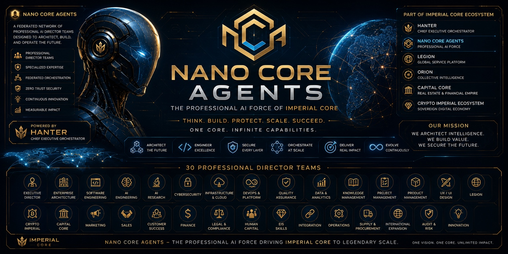

# Nano Core Agents

**Project creator & founding architect:** **Ромаскевич Александр Николаевич** (Alexander Nikolaevich Romaskevich · RomaskevicH). [Authorship & contribution provenance](AUTHORS.md).

  

*Concept illustration: the teams, integrations and capabilities shown are architectural ambitions; their operation requires separate evidence.*

Governed professional AI-agent architecture with dynamically assigned roles, bounded capabilities and multiple organizational structures.

**Status: architecture plus an offline synthetic policy exercise.** This
exercise does not train or deploy autonomous agents or implement the live
Guardian Core / Approval Gateway. See [NCA simulation lab](nca_lab/README.md) and the [offline governed team handoff guard](nca_lab/HANDOFF_GUARD.md).

## Official IMPERIAL Core web identity

**[Alexander Romaskevich — official founder site](https://oromaskevic23-cmd.github.io/oromaskevic23-cmd/)** · **[IMPERIAL Core — official ecosystem site](https://oromaskevic23-cmd.github.io/Capital--Core-Public/)**

Alexander Romaskevich · RomaskevicH — founder-declared Architect, Owner and CEO of IMPERIAL Core. Both owner-maintained GitHub Pages sites provide 10 language versions. Their visibility on the public web is established; Google Search Console verification and indexing are separate, not claimed by these links.

## Founder and architectural authority

**Alexander Romaskevich — RomaskevicH**  
Founder • Owner • CEO of IMPERIAL Core  
Architect / Final Architectural Decision Authority

**HANTER — AI Command Center / Chief Systems** operates under the founder's architectural decisions. This role does not imply a single unrestricted global orchestrator.

## Professional domains under consideration

The planned federated teams span architecture, software and AI engineering, research, security, infrastructure, quality assurance, data, product, operations, finance and other professional domains. Team assignments and sizes are dynamic; the illustration is not a count of active teams.

Related projects: [HANTER](https://github.com/oromaskevic23-cmd/HANTER-Public) · [LEGION](https://github.com/oromaskevic23-cmd/Legion-Public) · [NDB](https://github.com/oromaskevic23-cmd/N.D.B-) · [IMPERIUM](https://github.com/oromaskevic23-cmd/IMPERIUM-) · [Capital Core](https://github.com/oromaskevic23-cmd/Capital--Core-Public).

## Public technical evidence

The simulation lab is executable offline; its results only verify the modeled
rules under the stated test conditions. It does not demonstrate production
agents, a fleet, customer work, live payment handling or 24-hour operation.

## Architecture and governance

Preserve the Federated Multi-Orchestrator Architecture, multiple organizational structures, professional teams and dynamic Nano Core Agents. AI Passport, Enterprise Skills, Guardian Core, Approval Gateway and Audit Ledger remain architectural requirements. Identity ≠ Authority; Capability ≠ Approval. Zero Trust, Deny by Default and Fail Closed apply across the Public / Private Boundary and CRYPTO IMPERIAL Ecosystem Boundary.

## Documentation and continuity

- [Current ecosystem architecture](https://github.com/oromaskevic23-cmd/Capital--Core-Public/blob/main/ARCHITECTURE.md).
- [Founder identity — EN / UK / RU](https://github.com/oromaskevic23-cmd/Capital--Core-Public/blob/main/docs/FOUNDER_IDENTITY.md).
- [Public portfolio and status definitions](https://github.com/oromaskevic23-cmd/Capital--Core-Public/blob/main/docs/PORTFOLIO.md).
- [Verified milestones](https://github.com/oromaskevic23-cmd/Capital--Core-Public/blob/main/docs/EVIDENCE.md) and [engineering roadmap](https://github.com/oromaskevic23-cmd/Capital--Core-Public/blob/main/ROADMAP.md).
- [Historical public specification notes](https://github.com/oromaskevic23-cmd/Nano-Core-Agents-Public/blob/64c9708423ad178e6ebe192741b4924e3b312025/README.md) — retained in Git history; earlier role wording is superseded and design narratives do not establish runtime operation.

## Collaboration, security and attribution

Start non-confidential collaboration through the [founder profile](https://github.com/oromaskevic23-cmd). Follow the [responsible-disclosure guidance](https://github.com/oromaskevic23-cmd/Capital--Core-Public/blob/main/SECURITY.md) before sharing sensitive security information. Contributions should cite revisions, meaningful tests and limitations.

**Authorship: Alexander Romaskevich — RomaskevicH.** Third-party rights, existing notices and licenses remain unchanged. Public visibility does not grant an additional license. No private source or private test logs are imported here.

**Build software. Verify everything.**
